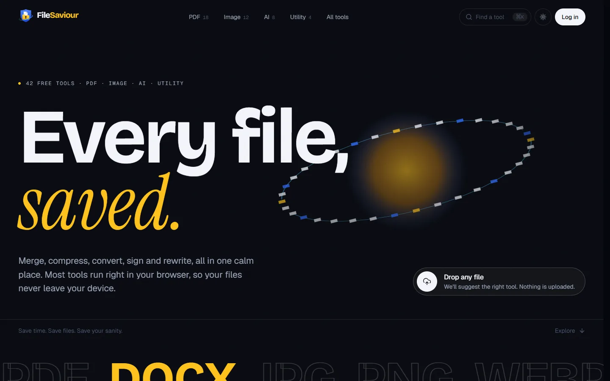
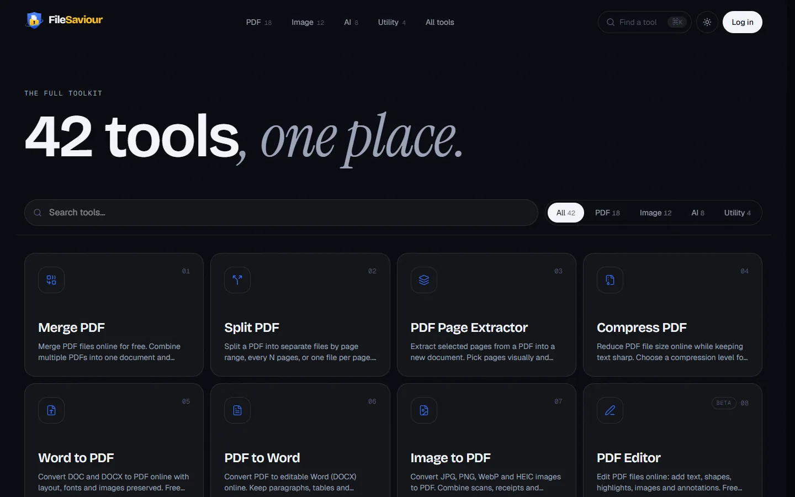
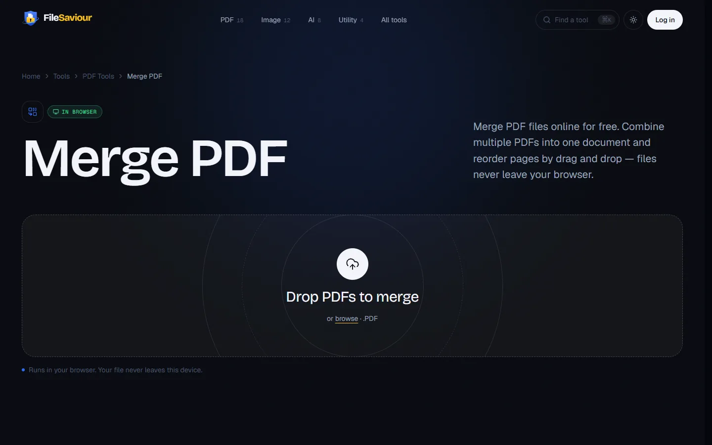
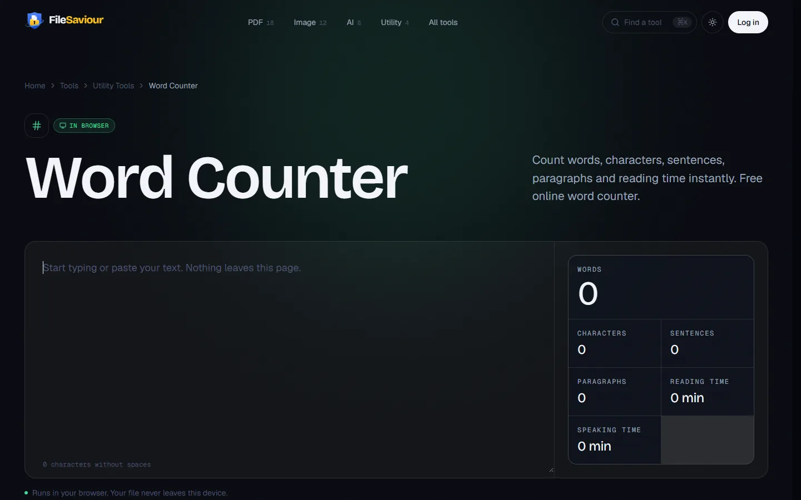
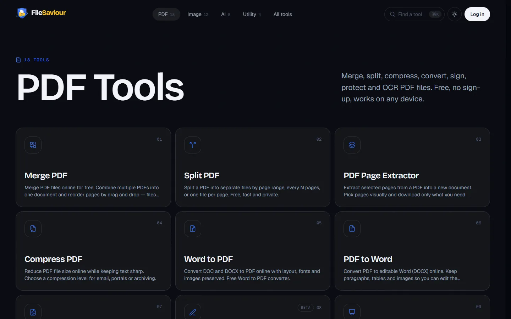
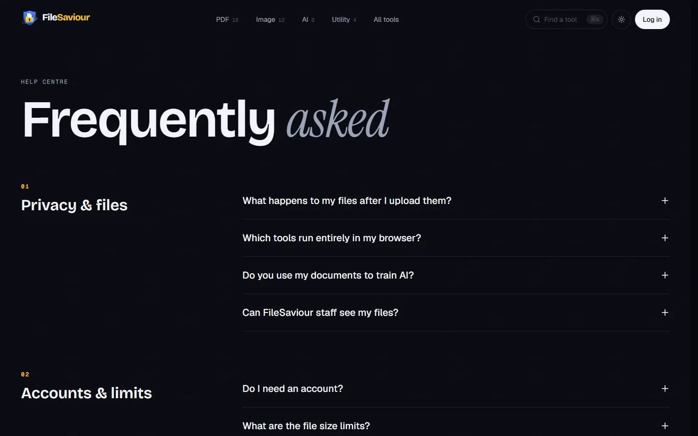
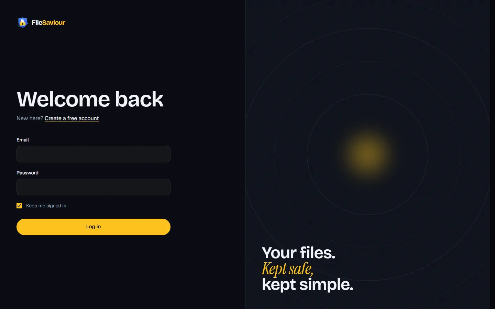
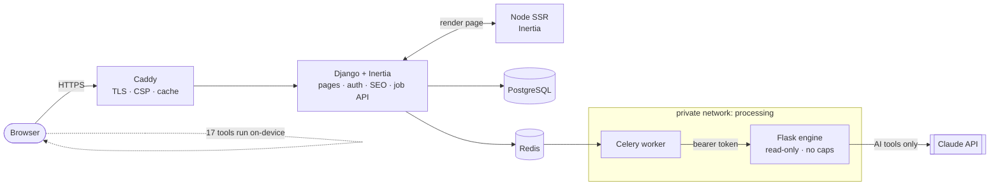
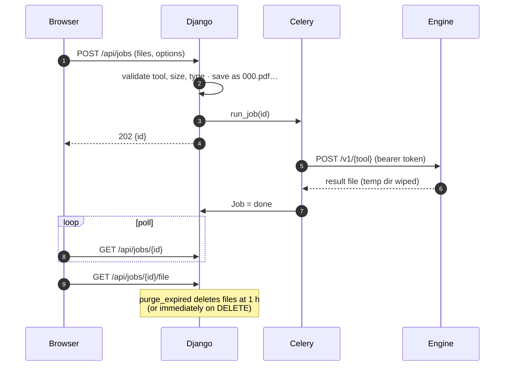
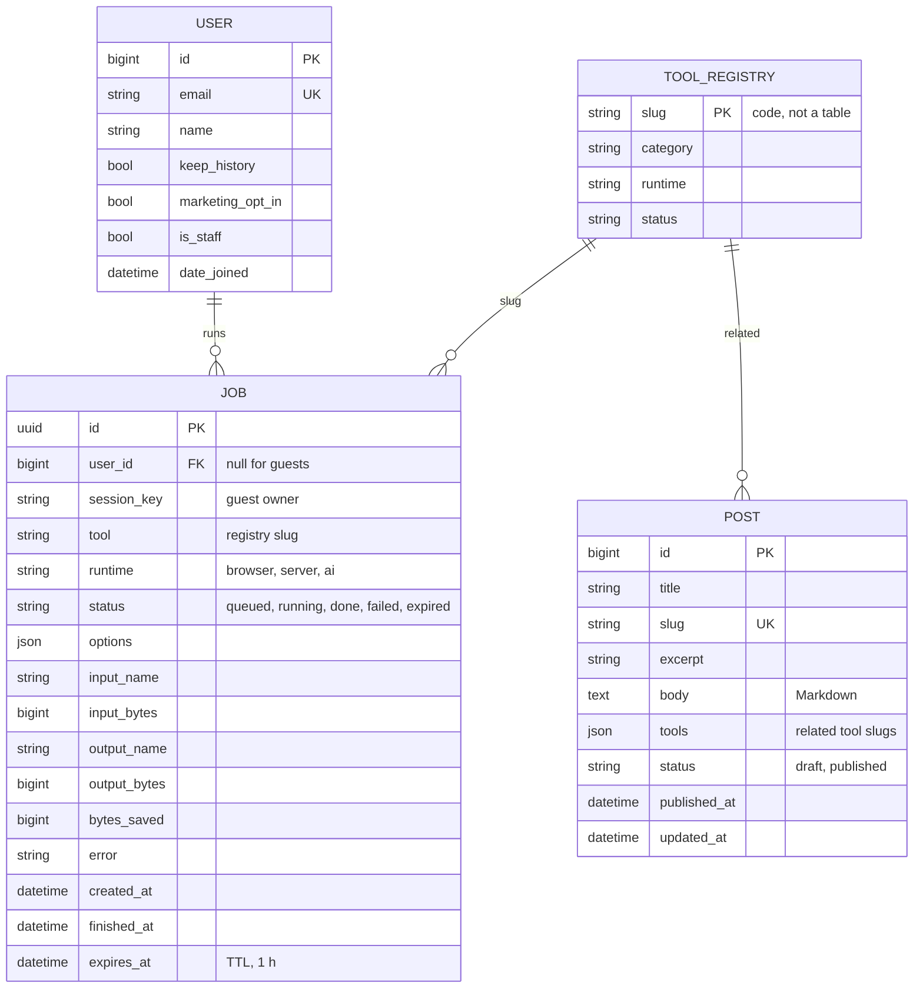

<div align="center">
 
<a href="https://filesaviour.ahmershah.dev">
  <picture>
    <source media="(prefers-color-scheme: dark)" srcset="backend/static/brand/logo-horizontal-dark.svg">
    
  </picture>
</a>

### Save time. Save files. Save your sanity.

42 free PDF, image, AI-writing and utility tools in one calm, private workspace.<br>
Most tools run **entirely in your browser**, so your files never leave your device.

[**Live site**](https://filesaviour.ahmershah.dev) · [Architecture](docs/ARCHITECTURE.md) · [Design system](docs/DESIGN.md) · [SEO](docs/SEO.md) · [Wiki](../../wiki)




</div>

---

## Contents

- [Highlights](#highlights)
- [Screenshots](#screenshots)
- [Quick start](#quick-start)
- [Tool catalog](#tool-catalog)
- [Tech stack](#tech-stack)
- [Architecture](#architecture)
- [Data model](#data-model)
- [Project structure](#project-structure)
- [SEO & AI discoverability](#seo--ai-discoverability)
- [Deployment](#deployment)
- [Contributing](#contributing) · [Security](#security) · [Roadmap](#roadmap)

## Highlights

| | |
|---|---|
| 🛡️ **Private by architecture** | 17 tools run on-device (pdf-lib, Canvas, WASM). Server files live in an isolated sandbox and are deleted within **1 hour**. |
| ⚡ **Fast** | Code-split per page. three.js, pdf-lib and the command palette load only when needed. Server-rendered HTML via Inertia SSR. |
| 🎨 **Award-level design** | "Vault" design system, WebGL orbit hero, editorial type, dark and light themes, `prefers-reduced-motion` support. |
| 🔎 **SEO-first** | Server-rendered meta and JSON-LD on every page, a single `sitemap.xml`, `robots.txt`, `llms.txt`, `llms-full.txt`, RSS and a generated OG card per tool. |
| 🧩 **One registry, 42 tools** | Add a tool in one Python file and its page, nav, sitemap, schema and OG image appear automatically. |
| 🧪 **Tested** | SEO contract tests, job privacy tests, service tests, ruff, strict TypeScript, GitHub Actions CI. |

## Screenshots

<table>
  <tr>
    <td width="50%"><br><sub><b>All tools</b>: search plus category filter, ⌘K anywhere</sub></td>
    <td width="50%"><br><sub><b>Tool page</b>: drop anywhere, runs in the browser</sub></td>
  </tr>
  <tr>
    <td><br><sub><b>Live workspace</b>: word counter and readability</sub></td>
    <td><br><sub><b>Category hub</b>: 18 PDF tools</sub></td>
  </tr>
  <tr>
    <td><br><sub><b>FAQ</b>: FAQPage schema</sub></td>
    <td><br><sub><b>Auth</b>: split-screen sign-in</sub></td>
  </tr>
</table>

## Quick start

> Requirements: **Python 3.12+** and **Node.js 22+**. Nothing else; there's no database server to install for local use.

```bash
git clone https://github.com/ahmershahdev/filesaviour.git
cd filesaviour
npm run dev
```

The first run creates the virtual environment, installs everything, migrates the database and builds the
frontend. It then starts Django and Vite together and opens **http://127.0.0.1:8000**. Later runs start in
seconds. Press `Ctrl+C` to stop.

| Command | What it does |
|---|---|
| `npm run dev` | Set up if needed, then run the site with hot reload |
| `npm run dev:engine` | Also start the processing engine (server and AI tools) |
| `npm run admin` | Create your admin account (for `/console`) |
| `npm test` | Django tests, ruff lint and TypeScript typecheck |
| `npm run build` | Production frontend build (client + SSR) |
| `npm run seo` | Refresh the SEO snapshots in `docs/seo/` |

Every command runs from the repo root and works the same on Windows, macOS and Linux. In development,
emails (password resets, contact form) are printed to the terminal instead of being sent.

<details>
<summary>Manual setup (without npm)</summary>

```bash
cd backend && python -m venv .venv
.venv/Scripts/pip install -r requirements/dev.txt     # macOS/Linux: .venv/bin/pip
.venv/Scripts/python manage.py migrate
.venv/Scripts/python manage.py runserver              # terminal 1

cd frontend && npm ci && npm run dev                  # terminal 2
```

Open http://127.0.0.1:8000. Use Django's port; Vite on :5173 only serves assets.
</details>

## Tool catalog

🖥️ runs in your browser · 🔒 isolated server, deleted ≤ 1 h · ✨ AI via Claude, never used for training

<!-- Generated from backend/apps/tools/registry.py -->
<details><summary><b>PDF Tools</b> (18)</summary>

| Tool | Runs | What it does |
|---|---|---|
| [Merge PDF](https://filesaviour.ahmershah.dev/merge-pdf) | 🖥️ Browser | Merge PDF files online for free. |
| [Split PDF](https://filesaviour.ahmershah.dev/split-pdf) | 🖥️ Browser | Split a PDF into separate files by page range, every N pages, or one file per page. |
| [PDF Page Extractor](https://filesaviour.ahmershah.dev/extract-pdf-pages) | 🖥️ Browser | Extract selected pages from a PDF into a new document. |
| [Compress PDF](https://filesaviour.ahmershah.dev/compress-pdf) | 🔒 Server | Reduce PDF file size online while keeping text sharp. |
| [Word to PDF](https://filesaviour.ahmershah.dev/word-to-pdf) | 🔒 Server | Convert DOC and DOCX to PDF online with layout, fonts and images preserved. |
| [PDF to Word](https://filesaviour.ahmershah.dev/pdf-to-word) | 🔒 Server | Convert PDF to editable Word (DOCX) online. |
| [Image to PDF](https://filesaviour.ahmershah.dev/image-to-pdf) | 🖥️ Browser | Convert JPG, PNG, WebP and HEIC images to PDF. |
| [PDF Editor](https://filesaviour.ahmershah.dev/edit-pdf) `beta` | 🖥️ Browser | Edit PDF files online: add text, shapes, highlights, images and annotations. |
| [PDF to PowerPoint](https://filesaviour.ahmershah.dev/pdf-to-powerpoint) | 🔒 Server | Convert PDF to PowerPoint (PPTX) online. |
| [PDF to Excel](https://filesaviour.ahmershah.dev/pdf-to-excel) | 🔒 Server | Extract tables from PDF to Excel (XLSX). |
| [Sign PDF](https://filesaviour.ahmershah.dev/sign-pdf) | 🖥️ Browser | Sign PDF documents online. |
| [Protect PDF](https://filesaviour.ahmershah.dev/protect-pdf) | 🔒 Server | Password-protect a PDF with AES-256 encryption. |
| [HTML to PDF](https://filesaviour.ahmershah.dev/html-to-pdf) | 🔒 Server | Convert a web page URL or HTML file to PDF with accurate CSS rendering. |
| [Crop PDF](https://filesaviour.ahmershah.dev/crop-pdf) | 🖥️ Browser | Crop PDF margins and page areas online. |
| [Translate PDF](https://filesaviour.ahmershah.dev/translate-pdf) `beta` | ✨ AI | Translate PDF documents into 30+ languages with AI while keeping the original layout as closely as possible. |
| [OCR PDF](https://filesaviour.ahmershah.dev/ocr-pdf) | 🔒 Server | Make scanned PDFs searchable with OCR. |
| [Compare PDF](https://filesaviour.ahmershah.dev/compare-pdf) | 🔒 Server | Compare two PDFs and highlight every text change side by side. |
| [Add Page Numbers](https://filesaviour.ahmershah.dev/add-page-numbers) | 🖥️ Browser | Add page numbers to a PDF online. |

</details>

<details><summary><b>Image Tools</b> (12)</summary>

| Tool | Runs | What it does |
|---|---|---|
| [Compress Image](https://filesaviour.ahmershah.dev/compress-image) | 🖥️ Browser | Compress JPG, PNG, WebP and GIF images online. |
| [Resize Image](https://filesaviour.ahmershah.dev/resize-image) | 🖥️ Browser | Resize images to exact pixels, percentage or social media presets. |
| [Crop Image](https://filesaviour.ahmershah.dev/crop-image) | 🖥️ Browser | Crop images online to any size or aspect ratio — 1:1, 16:9, 4:5 and custom. |
| [Image Converter](https://filesaviour.ahmershah.dev/convert-image) | 🖥️ Browser | Convert images between JPG, PNG, WebP, AVIF, GIF and HEIC online. |
| [Bulk Crop Images](https://filesaviour.ahmershah.dev/bulk-crop-images) | 🖥️ Browser | Crop many images at once with the same ratio or size. |
| [Bulk Image Converter](https://filesaviour.ahmershah.dev/bulk-convert-images) | 🖥️ Browser | Convert hundreds of images to JPG, PNG, WebP or AVIF in one go. |
| [Bulk Image Compressor](https://filesaviour.ahmershah.dev/bulk-compress-images) | 🖥️ Browser | Compress many images at once. |
| [GIF Compressor](https://filesaviour.ahmershah.dev/compress-gif) | 🔒 Server | Compress animated GIFs online. |
| [Background Remover](https://filesaviour.ahmershah.dev/remove-background) | 🔒 Server | Remove image backgrounds automatically with AI. |
| [Image Enhancer](https://filesaviour.ahmershah.dev/enhance-image) `beta` | 🔒 Server | Upscale and enhance photos with AI. |
| [Watermark Remover](https://filesaviour.ahmershah.dev/remove-watermark) `beta` | 🔒 Server | Remove unwanted marks, text and objects from your own images with AI inpainting. |
| [AI Image Detector](https://filesaviour.ahmershah.dev/ai-image-detector) `beta` | ✨ AI | Check whether an image is likely AI-generated. |

</details>

<details><summary><b>AI Writing Tools</b> (8)</summary>

| Tool | Runs | What it does |
|---|---|---|
| [AI Summarizer](https://filesaviour.ahmershah.dev/ai-summarizer) | ✨ AI | Summarize articles, PDFs and notes with AI. |
| [AI Paraphraser](https://filesaviour.ahmershah.dev/paraphrasing-tool) | ✨ AI | Paraphrase text with AI in fluent, formal, simple or creative modes while keeping the original meaning. |
| [Grammar Checker](https://filesaviour.ahmershah.dev/grammar-checker) | ✨ AI | Free AI grammar checker. |
| [AI Content Detector](https://filesaviour.ahmershah.dev/ai-content-detector) `beta` | ✨ AI | Estimate whether text was written by AI. |
| [AI Humanizer](https://filesaviour.ahmershah.dev/ai-humanizer) | ✨ AI | Make stiff, robotic drafts read naturally. |
| [Plagiarism Checker](https://filesaviour.ahmershah.dev/plagiarism-checker) `soon` | ✨ AI | Check text for plagiarism against web sources. |
| [Citation & Rewrite Assistant](https://filesaviour.ahmershah.dev/plagiarism-remover) `soon` | ✨ AI | Fix flagged passages properly: add citations or rewrite overlapping text in your own words. |
| [Content Improver](https://filesaviour.ahmershah.dev/content-improver) | ✨ AI | Improve writing tone, structure, flow and readability with AI. |

</details>

<details><summary><b>Utility Tools</b> (4)</summary>

| Tool | Runs | What it does |
|---|---|---|
| [Word Counter](https://filesaviour.ahmershah.dev/word-counter) | 🖥️ Browser | Count words, characters, sentences, paragraphs and reading time instantly. |
| [Text Analyzer](https://filesaviour.ahmershah.dev/text-analyzer) | 🖥️ Browser | Analyse readability, keyword density, sentence length and tone. |
| [File Converter](https://filesaviour.ahmershah.dev/file-converter) | 🔒 Server | Convert documents, spreadsheets, presentations and images between 50+ formats. |
| [File Optimizer](https://filesaviour.ahmershah.dev/file-optimizer) | 🔒 Server | Optimise PDFs, images and office files for upload limits, email and storage. |

</details>

## Tech stack

| Layer | Technology | Why |
|---|---|---|
| Web framework | **Django 6.1** | Auth, ORM, admin, migrations, sitemaps and syndication built in |
| SPA bridge | **Inertia.js 3** (`inertia-django`) | React pages with server-side routing; no separate REST API to maintain |
| UI | **React 19**, **TypeScript 5.9**, **Tailwind CSS 4**, **Vite 8** | Typed components, CSS-first design tokens, instant HMR |
| Motion & 3D | **Motion**, **Lenis**, **three.js** + **React Three Fiber** | Page transitions, inertial scroll, one-draw-call WebGL hero |
| In-browser engines | **pdf-lib**, Canvas, `createImageBitmap` | Private on-device processing |
| Processing engine | **Flask 3**, LibreOffice, Ghostscript, qpdf/pikepdf, Tesseract/OCRmyPDF, rembg | Untrusted-file parsing isolated from the app |
| AI | **Claude API** (`claude-opus-5-5`) | Summaries, rewriting, grammar, translation. Called only from the engine |
| Jobs | **Celery** + **Redis** | Off-request processing and TTL purge |
| Database | **PostgreSQL 17** (SQLite locally) | Users, job metadata, blog |
| Edge | **Caddy 2** | Automatic HTTPS, HSTS, CSP, compression |
| Quality | Django tests, **ruff**, strict `tsc`, **GitHub Actions**, Dependabot | |

## Architecture



**Job lifecycle (server and AI tools):**



The full design notes (security model, isolation, failure handling) are in [docs/ARCHITECTURE.md](docs/ARCHITECTURE.md).

## Data model



Tools are **code, not rows**: `backend/apps/tools/registry.py` is version-controlled, typed, and validated
at import (42 tools, unique slugs, descriptions ≤ 160 characters, valid related links).

## Project structure

```
filesaviour/
├── package.json · scripts/          `npm run dev` → scripts/run.mjs → scripts/run.py (setup + dev server)
├── backend/                          Django project
│   ├── config/settings/              base · dev · prod (env-driven)
│   ├── apps/
│   │   ├── core/                     pages, SEO (seo.py, sitemaps, og.py), robots/llms, content.py
│   │   ├── tools/                    registry.py ← single source of truth for 42 tools
│   │   ├── jobs/                     models · services.py (writes) · selectors.py (reads) · tasks · API
│   │   ├── accounts/                 email-login user, password reset, dashboard, services
│   │   ├── contact/                  contact form: model, services, rate limit, admin
│   │   ├── blog/                     posts + RSS
│   │   └── console/                  staff operations console
│   ├── templates/base.html           Inertia root + server-rendered <head>
│   └── static/brand/                 logo, favicon, icons, fonts
├── frontend/src/
│   ├── pages/                        thin Inertia pages (one chunk each)
│   ├── features/                     tools/ (components, workspaces) · home/ (WebGL) · auth/
│   ├── components/                   ui/ · layout/ · brand/ · seo/   (shared, feature-agnostic)
│   ├── layouts/ · lib/ · styles/     SiteLayout/AppLayout · utils · design tokens
│   └── main.tsx · ssr.tsx            client entry · SSR server
├── engine/                           Flask processing service + processors/
├── design/brand/                     logo system source (SVG builder)
├── deploy/Caddyfile · docker-compose.yml
├── docs/                             architecture, design, SEO, images, seo/ snapshots
└── .github/                          CI, Dependabot, templates, CODEOWNERS
```

Conventions: business logic lives in `services.py` / `selectors.py` (HackSoft Django style), never in views or
`save()`. Frontend code is grouped **by feature**; `components/` is only for shared, feature-agnostic pieces.

## SEO & AI discoverability

| File | Generated from | Snapshot |
|---|---|---|
| [`/sitemap.xml`](https://filesaviour.ahmershah.dev/sitemap.xml) | one sitemap: pages, tools, blog | [docs/seo/sitemap.xml](docs/seo/sitemap.xml) |
| [`/robots.txt`](https://filesaviour.ahmershah.dev/robots.txt) | crawl rules + explicit AI-crawler policy | [docs/seo/robots.txt](docs/seo/robots.txt) |
| [`/llms.txt`](https://filesaviour.ahmershah.dev/llms.txt) | [llmstxt.org](https://llmstxt.org) map of every tool | [docs/seo/llms.txt](docs/seo/llms.txt) |
| [`/llms-full.txt`](https://filesaviour.ahmershah.dev/llms-full.txt) | all tool docs, FAQ and policies | [docs/seo/llms-full.txt](docs/seo/llms-full.txt) |
| [`/rss.xml`](https://filesaviour.ahmershah.dev/rss.xml) | blog feed | [docs/seo/rss.xml](docs/seo/rss.xml) |
| `/og/<tool>.png` | 1200×630 card per tool | `manage.py build_brand_assets` |

These files are **generated live** by Django from the tool registry, so they never go stale. Snapshots in
`docs/seo/` are refreshed with `npm run seo`. Every page also ships JSON-LD:
`Organization`, `WebSite` + `SearchAction`, and per tool `WebApplication`, `HowTo`, `FAQPage` and
`BreadcrumbList`. Details are in [docs/SEO.md](docs/SEO.md).

## Deployment

```bash
cp .env.example .env && cp engine/.env.example .env.engine    # fill in secrets
docker compose up -d --build
docker compose exec web python manage.py createsuperuser
```

Point `filesaviour.ahmershah.dev` at the host. Caddy issues TLS automatically. The services are
`caddy`, `web`, `worker`, `beat`, `ssr`, `engine` (read-only, capability-dropped, private network),
`postgres` and `redis`.

## Contributing

See [CONTRIBUTING.md](CONTRIBUTING.md). In short: `npm test` must pass, keep logic in
services/selectors, and open a PR against `master`, which is protected and needs green CI.

## Security

Report vulnerabilities privately; see [SECURITY.md](SECURITY.md). Highlights: an isolated processing engine,
client filenames never touch disk, job IDs are non-enumerable, CSP/HSTS, and a 1-hour file TTL.

## Roadmap

- [x] 42-tool registry, pages, SEO, design system, brand
- [x] In-browser: merge PDF, image compress/resize/convert, word counter, text analyzer
- [x] Engine: compress/protect/OCR PDF, Word↔PDF, background remover, 6 AI writing tools
- [ ] Per-tool option panels (password, compression level, target language)
- [ ] Remaining in-browser engines: split, sign, crop and number PDFs, bulk image tools
- [ ] Rate limiting and ClamAV scanning before public launch
- [ ] Sandboxed HTML→PDF, PDF→PPTX/XLSX, compare, AI detectors

---

## License & credits

Released under the [MIT License](LICENSE.txt). © 2026 **Syed Ahmer Shah**.
You can use, modify and redistribute the code, including commercially, as long as the copyright notice and
the license text stay with it. The FileSaviour name and logo are not covered by the license.

**Created and maintained by Syed Ahmer Shah** (see [CREDITS.md](CREDITS.md))

[Website](https://ahmershah.dev) · [LinkedIn](https://linkedin.com/in/syedahmershah) · [GitHub](https://github.com/ahmershahdev) · [support@ahmershah.dev](mailto:support@ahmershah.dev)

---

<div align="center">
<sub>Designed & built by <a href="https://ahmershah.dev">Syed Ahmer Shah</a> · © 2026 FileSaviour · MIT License</sub>
</div>
